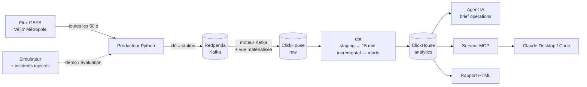

# Vélib Pulse — supervision temps réel d'un réseau de vélos partagés

> Pipeline de données temps réel sur le flux ouvert **Vélib' Métropole** (GBFS) :
> **Kafka/Redpanda → ClickHouse → dbt**, détection automatique des pannes et des déséquilibres,
> et un **agent IA** qui rédige le brief des équipes terrain et répond aux questions via **MCP**.

*EN — Real-time data platform on Paris bike-share open data: GBFS poller → Redpanda (Kafka) → ClickHouse
(Kafka engine + materialized views) → dbt (incremental models, tests) → anomaly detection
(silent stations, broken docks, closures, chronic imbalance) → LLM agent writing the ops brief, exposed
through an MCP server. Evaluated end-to-end against injected incidents.*

---

## Le problème

Un réseau comme Vélib', c'est plus d'un millier de stations qui remontent leur état en continu. Deux types de
problèmes coûtent cher :

- **les pannes techniques**, souvent silencieuses : une station qui ne remonte plus rien, des bornettes
  hors service, une station fermée. Elles ne se voient pas sur une carte « vélos disponibles » ;
- **les déséquilibres** : stations vides le matin en zone résidentielle, pleines au pied des bureaux.
  Il faut savoir où envoyer les camions de régulation, et combien de vélos déplacer.

Vélib Pulse transforme le flux brut en une liste d'actions priorisées, mise à jour en continu.

## Architecture



| Brique | Choix | Pourquoi |
|---|---|---|
| Transport | **Redpanda** (API Kafka) | Découple la collecte du stockage, rejouable ; clé = station → ordre garanti par station |
| Ingestion | **Moteur Kafka de ClickHouse** + vue matérialisée | Pas de consommateur à maintenir : ClickHouse lit le topic lui-même |
| Stockage | **ClickHouse**, MergeTree partitionné par jour, TTL 90 j | Agrégations sur des millions de relevés en millisecondes |
| Transformation | **dbt** (dbt-clickhouse), modèle 15 min **incrémental** | Seuls les quarts d'heure récents sont recalculés à chaque exécution |
| Qualité | 17 tests dbt + test métier (vélos ≤ capacité) + fraîcheur de la source | Une donnée fausse ne doit pas déclencher un camion |
| IA | Claude en **boucle agentique** (tool use) + **serveur MCP** | L'agent enquête (historique d'une station, SQL) avant de conclure |

## Ce qui est détecté

| Anomalie | Règle (seuils dans `dbt_project.yml`) | Gravité |
|---|---|---|
| `STALE_DATA` — station muette | Plus de remontée depuis > 60 min alors qu'elle est installée | critique |
| `DOCKS_UNAVAILABLE` — bornettes HS | Vélos + places libres < 75 % de la capacité pendant 2 h | élevée |
| `OUT_OF_SERVICE` — station fermée | Ni prêt ni retour depuis > 30 min | élevée |
| `CHRONIC_EMPTY` / `CHRONIC_FULL` | Quasi vide (< 2 vélos) ou quasi pleine plus de 60 % de la journée | moyenne |

Une station muette est exclue des autres contrôles : ses valeurs figées ne sont plus fiables. La priorité
pondère la gravité par la taille de la station. Un mart séparé calcule le **plan de régulation** :
stations à vider ou à remplir, et nombre de vélos à déplacer pour revenir à mi-capacité.

## Résultats

Évaluation de bout en bout (`make eval`) : 5 simulations × 150 stations × 48 h, 10 incidents injectés
par simulation, pipeline complet rejoué à chaque fois (chargement ClickHouse → `dbt build` → comparaison).

| Type | Détectés | Manqués | Fausses alertes | Écart médian sur l'heure de début |
|---|---|---|---|---|
| Station muette | 15 | 0 | 0 | 1 min |
| Bornettes HS | 10 | 0 | 0 | 14 min |
| Station fermée | 5 | 0 | 0 | 5 min |
| Toujours vide | 10 | 0 | 0 | — |
| Toujours pleine | 10 | 0 | 0 | — |

**Rappel 100 % (50/50), aucune fausse alerte.**

Ce que l'évaluation a changé : la première version ne retrouvait que **5 stations « toujours vides » sur
10**. Les stations manquées étaient les grandes (45 à 60 places), qui gardaient en permanence 1 ou 2 vélos
coincés : jamais vides au sens strict, mais inutilisables en pratique. La règle compte désormais les
stations **quasi vides** (moins de 2 vélos), et le rappel est passé de 90 % à 100 %.

À lire avec recul : les données sont simulées, avec des signaux plus nets que le flux réel. Ces chiffres
valident la logique de détection, pas sa performance en production. Les seuils sont à recalibrer sur
quelques semaines de données réelles.

## Démarrage rapide

### Démo sans Docker (ClickHouse embarqué)

```bash
pip install -r requirements-dev.txt
make dev-server            # terminal 1 : ClickHouse embarqué (chDB) sur :8123
make demo                  # terminal 2 : 48 h simulées → ClickHouse → dbt → reports/velib_pulse.html
make brief                 # brief opérations dans le terminal
make test                  # 12 tests, dont un de bout en bout sur un vrai moteur ClickHouse
make eval                  # évaluation sur 5 simulations
```

### Pile complète sur le flux réel

```bash
docker compose up -d --build          # Redpanda, console (:8080), ClickHouse (:8123), producteur
export CLICKHOUSE_PASSWORD=velib
make dbt                              # à planifier toutes les 5 min (cron, Airflow, Dagster…)
make report
```

### Agent IA et MCP

```bash
export ANTHROPIC_API_KEY=...
python -m velib_pulse.agent                                   # brief rédigé par Claude
python -m velib_pulse.agent "Pourquoi la station 17092 est-elle en alerte ?"
```

Sans clé d'API, l'agent produit un brief déterministe à partir des mêmes données.

Pour Claude Desktop, ajouter dans la configuration MCP :

```json
{
  "mcpServers": {
    "velib-pulse": {
      "command": "python",
      "args": ["-m", "velib_pulse.mcp_server"],
      "cwd": "/chemin/vers/velib-pulse",
      "env": { "CLICKHOUSE_HOST": "localhost", "CLICKHOUSE_PORT": "8123", "CLICKHOUSE_PASSWORD": "velib" }
    }
  }
}
```

| Outil MCP | Rôle |
|---|---|
| `network_status` | État du réseau, comparé à la veille même heure |
| `list_anomalies` | Pannes et déséquilibres actifs, triés par priorité |
| `rebalancing_plan` | Stations à rééquilibrer et vélos à déplacer |
| `station_history` | Historique d'une station par quart d'heure |
| `query_sql` | SQL en **lecture seule** sur les marts (écritures et fonctions d'accès fichiers ou réseau bloquées) |

## Modèles dbt

```
staging/       stg_velib__station_status       relevés dédoublonnés (rejeu Kafka), retard de remontée
               stg_velib__station_information  dernière version de chaque station
intermediate/  int_station_status_15min        station × quart d'heure, incrémental (delete+insert)
marts/         dim_station                     référentiel + profil d'usage (résidentielle, bureaux, mixte)
               mart_network_kpis_15min         santé du réseau par quart d'heure
               mart_station_anomalies          anomalies actives, gravité, priorité
               mart_rebalancing_needs          plan de régulation
```

Les anomalies sont calculées par rapport au **dernier relevé** et non à `now()` : le modèle se rejoue
sur n'importe quelle période d'historique, ce qui rend l'évaluation possible.

## Structure

```
velib_pulse/
├── gbfs.py         # client du flux GBFS et mise à plat
├── simulator.py    # réseau simulé déterministe + incidents injectés (vérité terrain)
├── sinks.py        # Kafka (production) ou ClickHouse direct (développement)
├── producer.py     # boucle de collecte
├── tools.py        # requêtes sur les marts (agent, MCP, rapport)
├── agent.py        # boucle agentique Claude + brief de repli
├── mcp_server.py
└── report.py       # rapport HTML autonome (graphiques SVG, carte, mode sombre)
sql/                # DDL ClickHouse : tables brutes, ingestion Kafka
dbt/                # projet dbt-clickhouse
devtools/           # serveur HTTP compatible ClickHouse sur chDB (dev et tests sans Docker)
eval/               # évaluation de bout en bout
tests/
```

## Ce qui a été vérifié, et comment

- **Testé ici, sur un vrai moteur ClickHouse** (chDB, ClickHouse embarqué, version 26.9) : DDL, chargement,
  `dbt build` complet (25 nœuds) via l'adaptateur dbt-clickhouse, outils, serveur MCP, rapport, évaluation.
- **Validé syntaxiquement, à tester sur Docker** : l'ingestion par le moteur Kafka et le `docker-compose.yml`.
  Le producteur Kafka est couvert par un test unitaire (clé, format JSON).
- `devtools/chdb_http_server.py` est un outil de **développement uniquement** : il émule l'interface HTTP de
  ClickHouse pour faire tourner dbt sans serveur. En production, un vrai serveur ClickHouse.

## Pistes

- Prévision de la demande par station (vides dans 30 min ?) pour anticiper la régulation
- Tableau de bord Grafana branché sur les marts
- Orchestration (Dagster) avec contrôle de fraîcheur de la source

## Stack

Python · Redpanda/Kafka (confluent-kafka) · ClickHouse (moteur Kafka, MergeTree, chDB) · dbt-clickhouse ·
Anthropic SDK (tool use) · MCP Python SDK · Docker Compose · pytest

---

**Auteur :** Fayçal Boubekri — AI & Data Engineer, Paris. Missions au forfait : agents IA, RAG, pipelines de données.
Données : flux GBFS ouvert de Vélib' Métropole (`https://velib-metropole-opendata.smovengo.cloud/opendata/Velib_Metropole/`)
